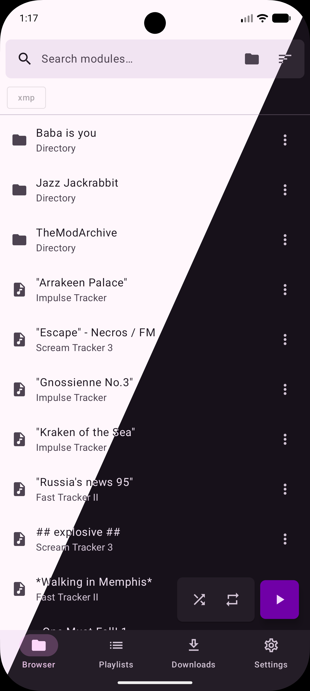
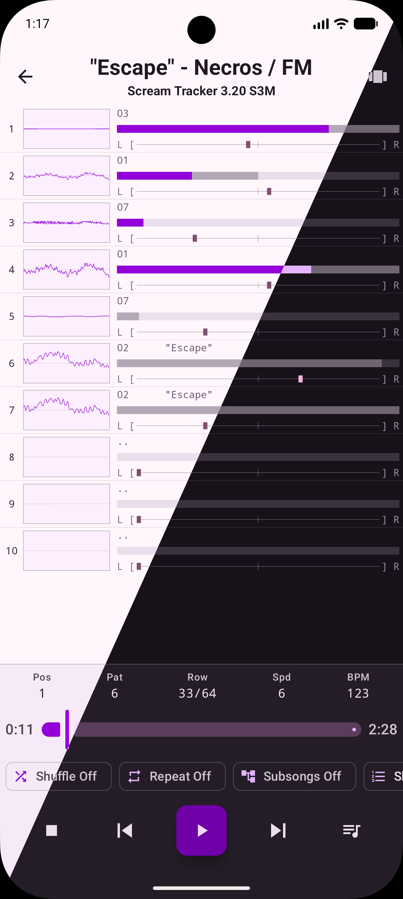
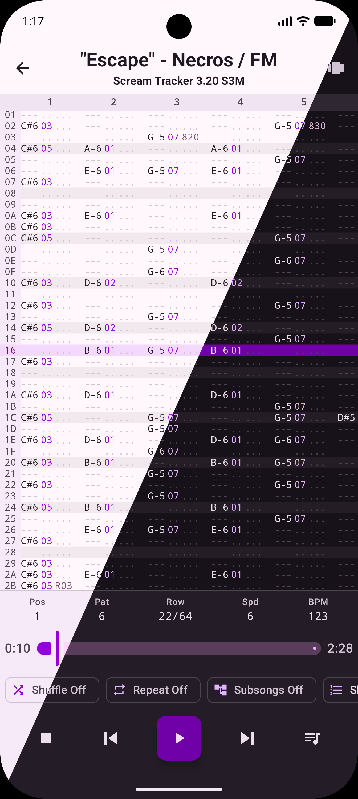
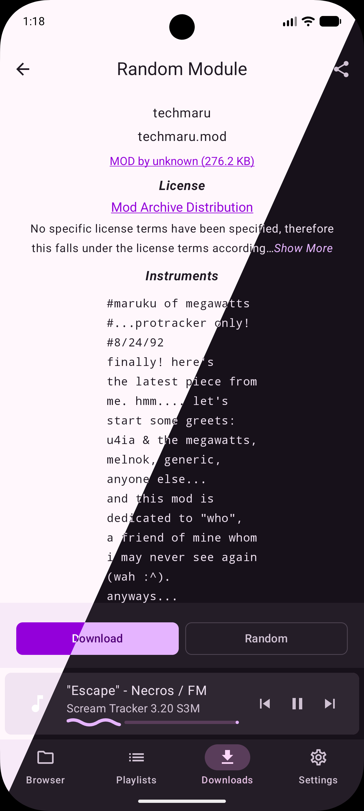

# Drakmod Player (Drake Mod Player)

A modern Android player for tracker music files — MOD, XM, IT, S3M, and dozens more. Built with Jetpack Compose, Media3, and Oboe for low-latency native audio playback.

A spiritual successor to [cmatsuoka/xmp-android](https://github.com/cmatsuoka/xmp-android), rebuilt with a modern Android look.

### Build Status (CI builds)

---
## Screenshots

  
  
  
  

*Light theme is still a work in progress; the dark theme is the primary target.*

---
## Features

### Playback
- **Supports 90+ tracker formats** via [libxmp](https://github.com/libxmp/libxmp) and [libopenmpt](https://github.com/OpenMPT/openmpt/) (MOD, XM, IT, S3M, MTM, STM, OKT, FAR, and more)
- **Selectable rendering backend** — switch between libxmp and libopenmpt
- **Low-latency audio** via Google's [Oboe](https://github.com/google/oboe) library
- **Gapless track transitions**
- **Background playback** with Media3 foreground service
- **Configurable audio settings**: sample rate, buffer size, amplification, stereo mixing, pan separation, interpolation, lowpass filter, and per-format player flags
- **Repeat modes and Shuffle**
- **Seek, queue navigation, and sub-song playback** for modules with multiple sequences

### Library
- **File browser** — browse your module folders, filter by name, and sort by name, type, or size
- **Playlists** — create, reorder, and edit playlists, with JSON import and export
- **Mod Archive downloads** — search [The Mod Archive](https://modarchive.org/), view module details, and download straight into your library, with a history of viewed modules

### Interface
- **Material 3 Expressive** UI with dynamic theming
- **Custom seed color picker** — recolor the entire app on the fly
- **AMOLED mode** — pure black backgrounds
- **Module info, instrument list, and song messages** viewable per track

### Integration
- **Android Auto support** — browse files and playlists, search, and play from your car
- **Voice playback** — in Android Auto, ask the assistant for a playlist or track by name; a bare "play music" resumes your queue or shuffles the library
- **Media session integration** — lock screen, watch, and notification controls

*Note: voice playback only works in Android Auto. Gemini on your phone won't hand requests to Drakmod Player, because Google only does that for apps published on the Play Store. Other assistants may work.*

### In Progress
*The app is in a usable state, but these are still being worked on:*
- **Playback view** — module pattern view and channel visualization
- **Queue persistence** — your playback state survives app restarts, with optional auto-resume
- **System playback resumption** — not working yet
- **Android Auto** — usable, still being polished

---

## Requirements
- Android 8.0 (API 26) or higher
- Architectures: arm64-v8a, armeabi-v7a

---

## Tech Stack
- Made in **Kotlin** with **Jetpack Compose**
- **Koin** for dependency injection
- **DataStore** for preferences
- **Room** for playlists
- **Navigation 3** for screen routing
- **Native C++ JNI bridge** to libxmp and libopenmpt

---

## Building
- Clone with submodules: `git clone --recursive …` (or `git submodule update --init --recursive`).
- The libopenmpt submodule is patched at CMake configure time with
  `renderer/src/main/cpp/patches/openmpt-waveform-api.patch` (adds channel/sample state and
  per-channel mute to the C API). After the first build `git status` will therefore show the
  submodule as modified — that is expected; don't commit or reset it.
- The Mod Archive search needs an API key: set `modArchiveApiKey="your-key"` (quotes included —
  the value is used as a Java string literal) in `~/.gradle/gradle.properties`, or
  `ORG_GRADLE_PROJECT_modArchiveApiKey` in the environment. Without one the app builds
  fine and search stays disabled until a key is entered in the Downloads section of Preferences
  (a key entered there always takes precedence over the compiled-in one).

---

## Featured Acknowledgements
- [libxmp](https://github.com/libxmp/libxmp) and [libopenmpt](https://github.com/OpenMPT/openmpt/) — the hearts of this player
- [cmatsuoka/xmp-android](https://github.com/cmatsuoka/xmp-android) — the original inspiration
- [Oboe](https://github.com/google/oboe) — Google's low-latency Android audio library
- [Material 3](https://m3.material.io/) and [MaterialKolor](https://github.com/jordond/MaterialKolor) for theming

---
## Credits

- [zeo](https://github.com/zeozeozeo) for libopenmpt support integration
---

## License
This project is licensed under the [MIT License](LICENSE).

Third-party library notices are listed in [NOTICE](NOTICE).
